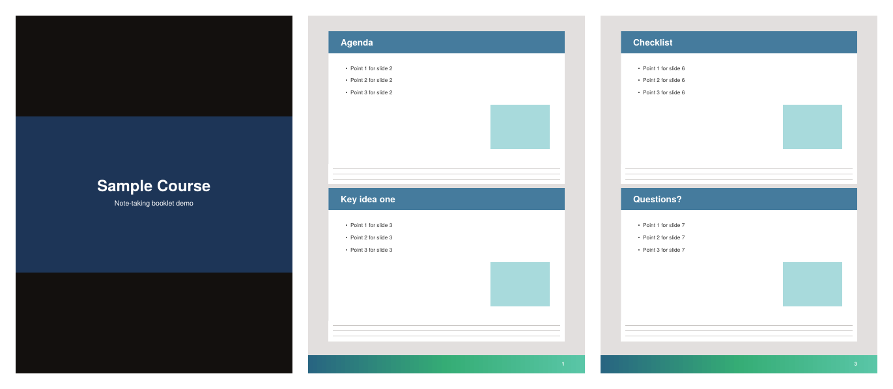

# Slides to booklet

Turns a slide deck PDF into a portrait note-taking booklet: a cover with the title slide, then 2 slides per page with 3 note lines under each, and a page number band at the bottom.



## The problem

Our live courses come with booklets so attendees can take notes next to the slides. We needed new ones in the same style for a course tour, from decks of up to 200 slides, and laying that out by hand doesn't scale.

PowerPoint's own handout layout doesn't help: it only adds note lines in the 3-slides-per-page version, where slides are too small to read.

## How it works

- Export the deck to PDF from PowerPoint (File > Export > PDF). Working from the PDF keeps fonts and layout exactly as designed, and avoids converting large decks with embedded videos.
- The script places each slide as vector content, so text stays sharp in print and the booklet is about the same file size as the deck.
- Repeated resources like logos and backgrounds are deduplicated, so a 200-slide deck builds in seconds.

The first real run produced booklets for a two-part course tour: 102 pages from Part 1 and 79 from Part 2, plus a standalone 18-page booklet cut from one section of another deck.

## Use it

**In the browser, no install:** download [`booklet-maker.html`](booklet-maker.html), open it in Chrome or Safari, drop in the slide PDF and click **Make booklet**. Everything runs locally with [pdf-lib](https://pdf-lib.js.org), so the deck never leaves your computer.

**From the command line:**

```
pip install pypdf reportlab
python3 booklet.py "My Deck.pdf" "My Deck Booklet.pdf"
```

If slide 1 is only a logo, pass the index of the real title slide (0-based) as a third argument. Slides before it are left out:

```
python3 booklet.py "My Deck.pdf" "My Deck Booklet.pdf" 1
```

To match your brand, change the colors at the top of [`booklet.py`](booklet.py).
